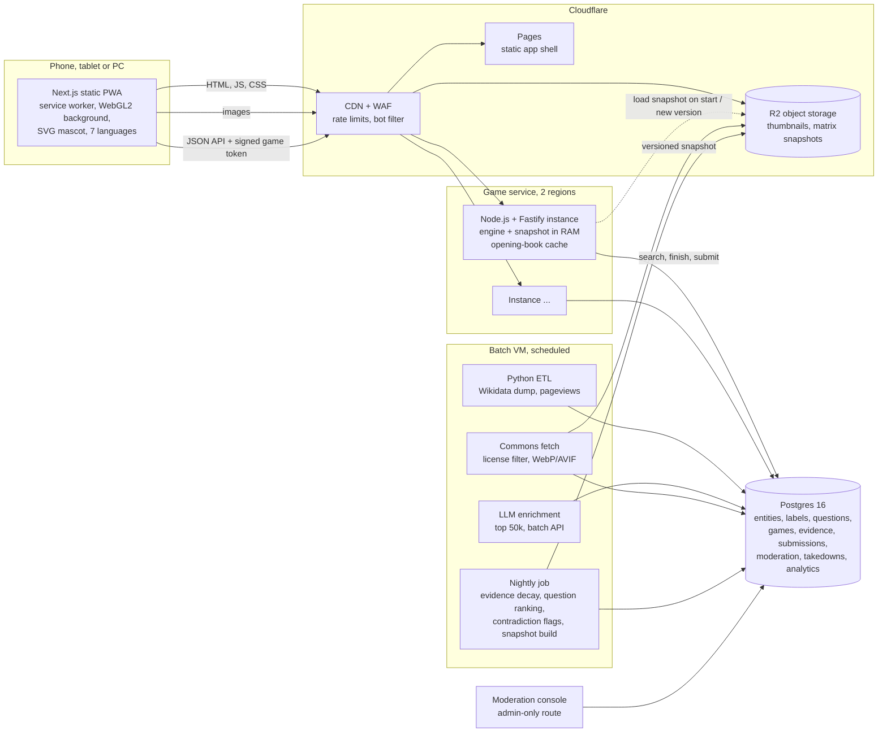
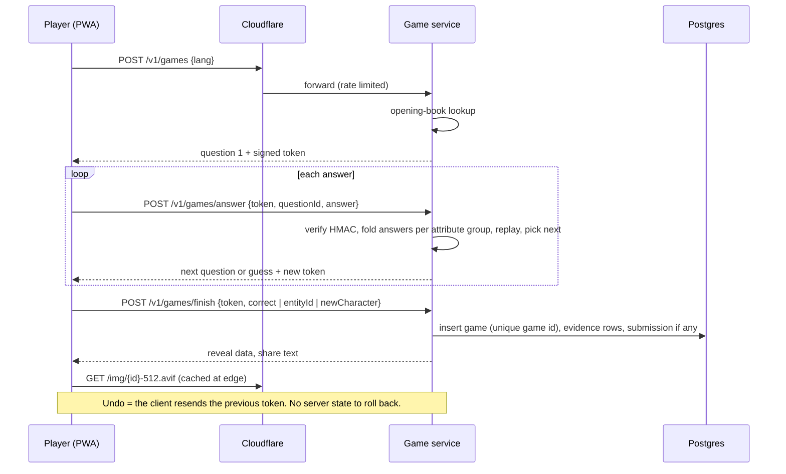
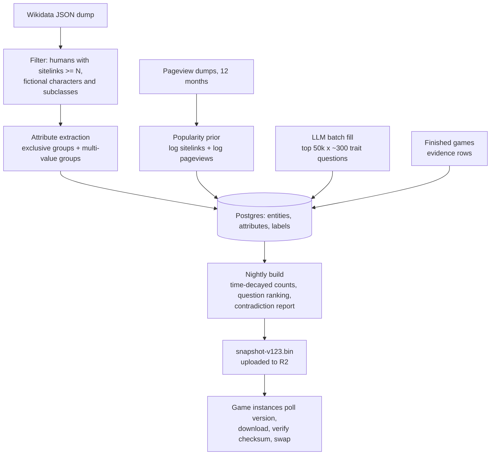

# MindReader: deliverable 1, architecture and tech stack

Status: proposal for your review. Nothing in steps 2 to 7 is built until you say "next".

## 1. Assumptions

1. **Traffic.** 100,000 daily players, 1.5 games each, about 22 API calls per game (start, about 18 answers, 1.5 guesses, finish, search). That is about 3.3M requests a day, 38 per second on average. I size for 190 per second at peak (5x average).
2. **Data.** Wikidata JSON dump (about 145 GB gzipped in 2025), monthly Wikipedia pageview dumps, and Commons image metadata. The pipeline runs monthly on a rented batch VM (8 vCPU, 32 GB RAM, 500 GB disk), not on the game servers.
3. **Characters.** About 350k real people and 150k fictional characters, as in your spec. I will tune the sitelink threshold on a 1% sample in step 2 and report the counts. I do not know the real counts yet.
4. **Questions.** About 3,000 to 5,000 questions generated from attributes, plus hand-written questions for traits Wikidata lacks (hair colour, wears a mask, can fly).
5. **Languages.** UI and questions in English, Hindi, Spanish, Portuguese, Japanese, French and Arabic (right to left). Character names and one-line descriptions come from Wikidata labels and descriptions in those languages (CC0), with English as fallback.
6. **Budget.** "Low monthly budget" means a target under USD 300 a month at 100k daily players. Step 7 has the real estimate.
7. **Minors.** Living people under 18 can be guessed only if they pass the notability threshold, and they never get a photo, only a generated card.
8. **The Python prototype in `prototype/` stays** as the reference implementation and simulator. It is a small working FastAPI version with 247 characters, 21 passing tests, and 93% wins in simulation with 10% wrong answers. New engine code in step 3 must match its behaviour on the same data.

## 2. Where I recommend a different approach than the spec

You asked me to propose better options where I see them. Each row works toward the same outcome you specified. The last column says whether I need your decision.

| # | Spec says | I recommend | Reason | Need your OK? |
|---|---|---|---|---|
| 1 | Session state in Redis, 30 min TTL | **No Redis.** The game state is a signed token (HMAC-SHA256) holding the answer list. The server replays it on every request. | The benchmark below shows a full replay plus question choice over 500k characters takes 38 ms median and 61 ms p95 at 40 answers. That removes a paid component and session-loss bugs, and any instance in any region can serve any request. | Yes |
| 2 | Store a sparse matrix of P(yes) cells | **"Virtual matrix"**: each character stores one value per attribute group (country, occupation, franchise...). P(yes) for "Is your character from India?" is computed from that value. Only learned and hand-filled cells are stored explicitly. | Storing "false" cells for exclusive groups explodes the matrix: one Indian character implies about 200 "not from country X" cells. The group form holds 500k characters in about 15 MB (measured). | No, design detail |
| 3 | Wikidata "false = 0.05" | Use 0.05 only **inside exclusive groups** (gender, real or fictional, alive, birth century, primary country). Elsewhere a missing fact stays 0.5. | Wikidata is open world: a missing "occupation: singer" does not mean the person never sang. Marking it false would wrongly punish the right character. | No |
| 4 | Expected information gain over the top K (about 2,000) | **Exact gain over all characters** for attribute questions, using three bucket sums per question (match, other known value, unknown). Top K only for the explicit sparse cells. | Exact gain is cheaper than the top-K version for group questions and never misses a question because the right character sat outside the top K. | No |
| 5 | Update the matrix from games | **Read-only snapshots.** Games write evidence rows to Postgres. A job rebuilds a versioned binary snapshot (nightly at first, hourly later), uploads it to object storage, and instances hot-swap it. | No locks or cross-instance drift, and rolling back a bad update means loading the previous file. | No |
| 6 | Wikidata only | **Wikidata plus offline LLM enrichment** for the top 50k characters: an LLM fills about 300 trait questions per character in batch mode. | Fictional characters on Wikidata often carry little more than gender and the work they appear in. Without enrichment I do not expect 80% accuracy on fictional characters. The research report estimates 5,000 x 500 cells at about USD 4.70 with Haiku 5.5 batch pricing, so 50,000 x 300 cells is roughly USD 30, plus a spot-check against Wikidata. | **Yes**: costs money and needs an API key |
| 7 | Genie mascot in Rive or Lottie | An **original mascot** (for example a small floating orb creature with eyes), drawn as SVG and animated with CSS and a JS state machine. | "AKINATOR" is a live US trademark (Reg. 6430444, per the research), and a turbaned genie in that style invites a trade-dress complaint. I also build original designs, not lookalikes. Rive needs files made in the Rive editor that I cannot produce as code; SVG is about 10 KB and can be swapped for Rive later. | **Yes**: mascot concept |
| 8 | WebGL with OGL or three.js | **Raw WebGL2**, one fragment shader, no library. | About 6 KB instead of 30 to 150 KB, and only one effect is needed. | No |
| 9 | Next.js | Next.js with **static export** (`output: "export"`) served from a CDN. No Node server for the frontend. | One page plus a few static routes do not need server rendering. Static HTML paints before any JS runs, which is the cheapest way to hit first paint under 1.5 s on 4G. | No |
| 10 | Pageviews per entity | Use the monthly **pageview dump files**, not the REST API. | 500k entities x 12 months is 6M API calls. The dumps give the same numbers in a few downloads. | No |
| 11 | Serve thumbnails from a CDN | **Pre-generate** 256 and 512 px WebP and AVIF for every character with a reusable Commons image and store them in Cloudflare R2 behind the CDN. | Commons download etiquette rules out fetching on demand at reveal time. R2 has no egress fees. | No |
| 12 | (not in spec) | An **opening-book cache**: the next question for common answer prefixes (the first 4 to 6 answers) is cached in memory. | Most games start the same way. Cached openings cost close to zero CPU and make the first questions instant. | No |
| 13 | Detect battery saver | **No web API reports OS battery saver.** I use the Battery Status API where it exists (Chromium only) plus a frame-time watchdog: if frames average over 40 ms for 2 s, drop resolution, then switch to the static gradient. | Same goal, done with signals that browsers actually expose. | No |

## 3. System architecture

### One game, request by request

### Knowledge-base lifecycle

## 4. Tech stack

| Layer | Choice | Why | Alternative considered |
|---|---|---|---|
| Frontend framework | Next.js 15 + TypeScript, static export | Your requirement. A static export keeps hosting free and first paint fast. | Vite + Preact: about 40 KB smaller JS. Worth it only if the step 5 bundle misses budget. |
| Background | Raw WebGL2 fragment shader, about 6 KB | One effect, no scene graph needed | OGL (about 30 KB), three.js (over 150 KB) |
| Mascot | Inline SVG + CSS keyframes + small TS state machine (idle, thinking, confident, surprised, happy) | Code-only, about 10 KB, themable, respects reduced motion | Rive (needs editor assets, about 70 KB runtime), Lottie (about 60 KB runtime) |
| Reveal effects | CSS 3D card flip + canvas confetti (about 2 KB, hand-written) | No library cost | canvas-confetti (about 6 KB) |
| PWA | Web manifest + hand-written service worker: cache-first app shell, network-only API | Full control, about 2 KB | Workbox (more features than needed) |
| i18n | JSON message files per locale, `dir="rtl"` for Arabic, `Intl` for numbers | No runtime library needed | next-intl |
| Game API | Node.js 22 + Fastify + TypeScript | Same language as the engine and its tests, fast JSON, typed schemas that become the OpenAPI spec in step 4 | Go: lower memory per instance. Switch only if load tests in step 7 fail. |
| Engine | TypeScript over typed arrays (Uint16Array, Float64Array), reusable buffers per worker | Benchmark below meets the budget with headroom | Rust compiled to WASM for the hot loop if needed later, behind the same interface |
| Game state | Signed token, HMAC-SHA256 (about 260 characters for a 40-answer game) | Stateless, see section 2 row 1 | Redis |
| Database | Postgres 16 with `pg_trgm` and `unaccent` | Entities, labels in 7 languages, typeahead search, evidence, moderation, analytics in one place | Meilisearch for search, if trigram search is too slow at 3.5M labels |
| Data pipeline | Python 3.12, streaming JSON parse of the gzipped dump (`orjson`, `indexed_gzip` or `pigz`), Parquet intermediates (`pyarrow`), DuckDB for joins | Streams 1.6 TB uncompressed without loading it into RAM. DuckDB joins Parquet faster than loading it into Postgres first. | Spark (too heavy), QLever SPARQL (good for exploration, not full extraction) |
| Images | Commons API `imageinfo` with `extmetadata` for license and author; `sharp` (libvips) to make WebP and AVIF | License allowlist: CC0, public domain, CC BY, CC BY-SA. Anything else gets a generated card. | Hotlinking Commons thumbnails (ruled out by your spec) |
| LLM enrichment | Claude Haiku 5.5 through the Message Batches API, JSON output, cached shared prompt | Cheapest option that handles 300 questions per call; batch pricing is 50% off | Larger models for a 1% audit sample only |
| Hosting | Cloudflare Pages + R2 + CDN; game service on Fly.io machines in 2 regions (Mumbai or Singapore, plus Frankfurt or US East); managed Postgres (Neon or Fly Postgres) | Edge caching is free, R2 has no egress fees, Fly scales machines on concurrency | Hetzner VMs + Docker: cheaper, but you handle failover yourself |
| Analytics | One row per finished or abandoned game in Postgres (answers, question count, outcome, device class, coarse country). Abandon is reported with `navigator.sendBeacon` on `pagehide`. | Drop-off per question comes from the abandon rows. No IPs or device IDs are stored with games. | Plausible, self-hosted |
| CI | GitHub Actions: type check, unit tests, engine accuracy regression on the 1,000-character sample, Lighthouse CI on a mid-range mobile profile | Catches accuracy or speed regressions before deploy | |

## 5. Engine feasibility benchmark (measured)

Script: `docs/spikes/engine-bench.mjs`. Synthetic data with 500,000 characters, 15 attribute groups, 3,325 questions, Zipf-distributed values and a long-tail popularity prior. Run on this session's 4-vCPU cloud container in Node.js 22, single thread.

| Answers replayed | Naive replay p50 / p95 | Folded replay p50 / p95 |
|---|---|---|
| 0 | 35 / 49 ms | 38 / 52 ms |
| 10 | 55 / 62 ms | 35 / 43 ms |
| 20 | 77 / 103 ms | 37 / 42 ms |
| 40 | 125 / 148 ms | 38 / 61 ms |

"Folded" means all answers about one attribute group are summed into one lookup table, so replay costs at most one pass per answered group, whatever the game length. Both versions give the same posterior (max difference 1.9e-16). Attribute memory: 15 MB.

What this does not cover yet: the explicit sparse cells (learned and LLM-filled), multi-value groups (a person with two occupations), and garbage collection under concurrent load. Step 3 adds the first two to the benchmark, and the step 7 load test measures the third.

**Capacity math.** About 38 ms of CPU per question request gives about 26 requests per second per core. At a 190 per second peak, with opening-book hits costing close to nothing, that is about 6 to 8 cores across all instances. Each instance needs about 300 MB of RAM for the snapshot plus working buffers.

## 6. Snapshot format (binary, little endian)

| Section | Content |
|---|---|
| Header | magic `MRSN`, format version, snapshot version, created time, entity count N, question count Q, group count, SHA-256 of the body |
| Entities | `Uint32Array` Wikidata numeric id (Q-number), `Float32Array` log prior, `Uint8Array` flags (real, has image, minor) |
| Groups | per group: name, exclusive flag, cardinality, then `Uint16Array(N)` value ids. Multi-value groups use a CSR pair (`Uint32Array` offsets, `Uint16Array` values). |
| Questions | per question: id (`Uint16`), kind (group value or sparse), group id and value id or sparse column index, `Float32` usefulness score, duplicate-cluster id |
| Sparse cells | CSC (per question: entity indices `Uint32`, p quantized to `Uint8`) for replay, and CSR (per entity: question ids `Uint16`, p `Uint8`) for top-K gain |

Names, descriptions and image metadata are not in the snapshot. The client gets them from the finish and search endpoints, backed by Postgres and cached at the edge. This keeps the engine's memory small.

## 7. Performance budgets for the frontend

| Item | Budget (compressed) |
|---|---|
| HTML + critical CSS (inlined) | 25 KB |
| JS needed to start a game | 110 KB |
| Shader + mascot + reveal effects | 20 KB, loaded after first paint |
| Fonts | 0 KB: system fonts (Android, iOS and Windows ship Devanagari, Japanese and Arabic fonts) |
| First paint on throttled 4G, mid-range Android | under 1.5 s |
| Background frame cost | under 4 ms per frame at 60 fps; under 8 ms at 30 fps on low-end; canvas at 0.5x device pixel ratio on low-end |

Low-end detection: `navigator.deviceMemory <= 4`, `navigator.hardwareConcurrency <= 4`, or the frame-time watchdog. The background pauses on `visibilitychange`.

## 8. Security, privacy and abuse

- **Game tokens** are HMAC-signed with a server secret rotated quarterly (two keys valid during rotation). A tampered token is rejected. Resending an old token only replays the game from that point, which is the same as undo.
- **Learning is counted once per game:** `finish` inserts with a unique game id (`ON CONFLICT DO NOTHING`).
- **Rate limits** at two layers: Cloudflare rules where your plan allows, and an in-process token bucket keyed by a salted hash of the IP. The salt rotates daily and the hash is never written to disk.
- **Player reliability** uses a random device id kept in `localStorage` and sent only with `finish`. It is stored hashed, never joined to an IP, and disclosed on the privacy page. Players who often contradict confident facts get less weight. I will ask you before adding anything that identifies people more than this.
- **Submissions** go to a moderation queue. Automatic checks: blocklist, an LLM classifier for hate and adult content, a Wikidata lookup (no article means probably a private person, so reject), and a birth-date check for minors.
- **Takedown form** at `/takedown`, stored in Postgres, emailed to the admin address. Hiding a character or image takes effect at the next snapshot, or immediately through a deny list the service checks.
- **Attribution:** "Data from Wikidata (CC0). Images from Wikimedia Commons, credited under each picture." Every photo shows author and license with a link.

## 9. Risks, ranked

1. **Fictional coverage quality.** The 80% target depends on the LLM enrichment in row 6. If you decline it, expect a lower accuracy target for fictional characters, which I will measure in step 3.
2. **Gap between data and player beliefs.** Players answer from perception ("Is Freddie Mercury British?"), not from Wikidata. The learning loop corrects this over time. Early accuracy will be lower than the simulations show.
3. **Commons licensing edge cases.** Some files carry extra restrictions, such as personality rights or trademark notices. The allowlist plus a "rights warning" check handles most of them. Takedowns handle the rest.
4. **Pipeline runtime.** A full dump pass takes hours. The 1% sample run in step 2 will measure it before the full run.
5. **Cold-start trolling.** Early games carry outsized weight. Learned evidence is capped per character per day, and new characters need several independent confirmations.

## 10. What you should test or decide for this step

1. **Decide** rows 1, 6 and 7 of section 2: stateless tokens instead of Redis, the LLM enrichment budget (about USD 30 one-time), and an original mascot instead of a genie.
2. **Run the benchmark** on the machine type you plan to rent: `node docs/spikes/engine-bench.mjs`. The p95 at 40 answers should stay under 150 ms. If it does not, plan more instances or the WASM option.
3. **Check the diagrams** render: GitHub renders Mermaid in this file automatically.
4. **Play the prototype** to get a feel for pacing: `cd prototype && pip install -r requirements.txt && uvicorn app.main:app`, then open http://localhost:8000.
5. **Confirm the hosting region pair** (Mumbai or Singapore plus Frankfurt or US East) based on where you expect your players.
